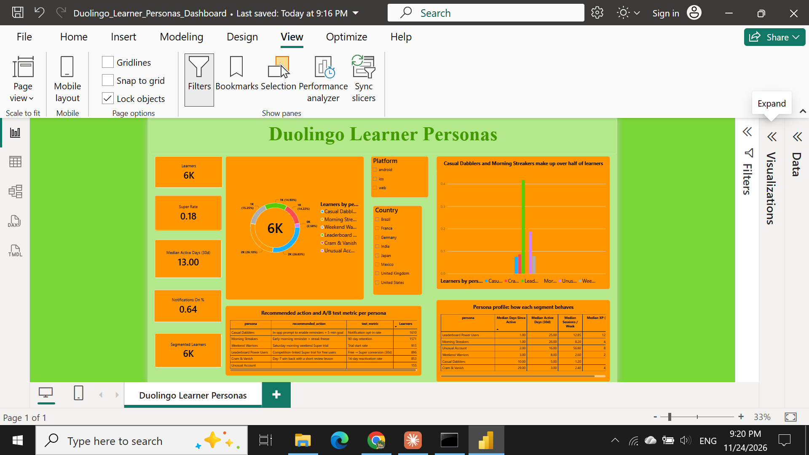

# Duolingo Learner Personas: Behavioral Segmentation & Power BI Dashboard

Segmenting 6,000 language-app learners into five actionable personas with K-Means, then turning each persona into a product action and an A/B test metric. Delivered as a Python notebook and a one-page Power BI dashboard.



## Business problem
One-size-fits-all reminders treat every learner the same. The growth team needs to know **who the learners are** and **what to do differently for each group**.

## Key findings
| Persona | Share of learners | Recommended action | A/B test metric |
|---|---|---|---|
| Casual Dabblers | 27.5% | In-app prompt to enable reminders + 5-minute daily goal | Notification opt-in rate |
| Morning Streakers | 26.9% | Early-morning reminder + streak freeze | 90-day retention |
| Weekend Warriors | 15.7% | Saturday-morning weekend Super trial | Trial start rate |
| Leaderboard Power Users | 15.3% | Competition-linked Super trial for free users | Free to Super conversion (30d) |
| Cram & Vanish | 14.6% | Day-7 win-back with a short review lesson | 14-day reactivation rate |

- Only **34.5%** of Casual Dabblers have notifications on, against 72 to 76% in the other personas.
- **58%** of Leaderboard Power Users are still on the free plan, making them the best Super upsell target.
- Cram & Vanish learners have reminders on but have been silent for about a month, so the win-back message should go out at day 7, not day 29.

## Approach
1. **Exploration and cleaning:** duplicates, 1.5% missing session length (median imputation), skew analysis.
2. **Unusual accounts:** 155 learners (2.6%) with more than 50 sessions/week or average sessions over 3 hours were set aside and labelled `-1`.
3. **Feature engineering:** `log1p` on skewed volume and recency features, then standard scaling of 11 behavior features. Context columns (country, platform, subscription) describe personas but do not drive clustering.
4. **Clustering:** K-Means with elbow and silhouette analysis, seed-stability check (ARI 0.999 at k=5), compared against hierarchical (Ward) and Gaussian mixture models.
5. **Profiling:** persona names verified against the data with assertions, so labels can't silently drift on a re-run.
6. **Dashboard:** one-page Power BI report with DAX measures and a custom theme.

## Model validation
- Silhouette is about 0.21 at k=5. It is low for every k, which is typical for behavioral data that forms a continuum, so the choice of k also rests on stability and actionability.
- K-Means is stable across seeds at k=5 and unstable at k=6 (ARI 0.685).
- Hierarchical clustering agrees with K-Means (ARI 0.79) and a spherical GMM agrees closely (ARI 0.93), so the segments are robust to the method.

## Limitations
- Overlapping groups: personas describe tendencies, not hard boundaries (Leaderboard Power Users and Morning Streakers overlap).
- Rule-based thresholds for unusual accounts are judgment calls and need review by a fraud or data-quality team.
- Correlation is not causation: every recommendation needs an A/B test before rollout.
- Single 90-day snapshot, so seasonality and persona migration over time are not captured.

## Repository structure
```
duolingo-learner-personas/
├── data/                  # learners.csv (source data)
├── notebooks/             # duolingo_learner_personas.ipynb
├── outputs/               # clusters.csv, learners_clustered.csv, persona_profiles.csv, persona_recommendations.csv
├── powerbi/               # Duolingo_Learner_Personas_Dashboard.pbix, duolingo_theme.json, DAX_and_build_guide.md
├── dashboard/             # dashboard_overview.png, dashboard PDF
├── requirements.txt
└── README.md
```

## How to run
```bash
git clone https://github.com/<your-username>/duolingo-learner-personas.git
cd duolingo-learner-personas
pip install -r requirements.txt
jupyter notebook notebooks/duolingo_learner_personas.ipynb
```
Place `learners.csv` in `data/` first. The notebook writes its results to `outputs/`.

**Power BI:** open `powerbi/Duolingo_Learner_Personas_Dashboard.pbix`, or load `outputs/learners_clustered.csv`, apply `duolingo_theme.json`, and add the measures from `DAX_and_build_guide.md`.

## Tech stack
Python (pandas, NumPy, scikit-learn, seaborn, matplotlib), K-Means, Gaussian Mixture, Hierarchical Clustering, PCA, Power BI, DAX.

## Dataset
Duolingo-style learner activity dataset (StrataScratch project): 6,000 learners, 18 columns, last 90 days of activity.

## Author
**Your Name** | [LinkedIn](https://linkedin.com/in/your-profile) | [Portfolio](https://your-portfolio-link)
